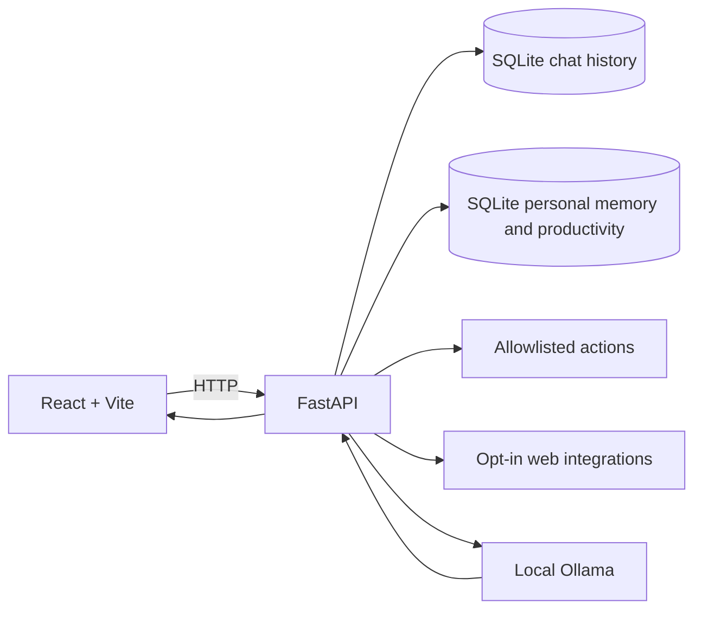

# JARVIS AI Desktop Assistant

JARVIS is a local-first AI desktop assistant built from a FastAPI backend, a React + Vite interface, SQLite persistence, Ollama inference, and an Electron shell. Core chat and memory stay local. Optional internet lookups are separate and user-triggered.

## Current capabilities

- Send chat requests to an Ollama model running on the local machine.
- Store and retrieve chat history in `data/jarvis.db`.
- Create, list, and delete personal memories independently from chat history.
- Include up to three text-matched memories in the model context for a chat request.
- Inspect Ollama connectivity and installed models through the API.
- Select an already installed Ollama model for the current backend process.
- Use push-to-listen browser speech recognition and browser/system speech synthesis, with voice and rate controls.
- Create, search, and manage notes; track tasks; schedule reminders and optionally receive desktop notifications.
- Preview and confirm a small allowlist of desktop actions. Arbitrary command execution is not supported.
- Request web search, weather, and public GitHub repository data explicitly.
- View system metrics and build a Linux AppImage with a bundled API executable.

Personal-memory retrieval uses substring matching rather than semantic search. Model selection resets when the backend restarts. Browser speech-recognition availability and audio handling depend on the browser and may use a browser-provided service; it is not guaranteed to be offline. Account-based calendar/email integrations, always-on wake-word detection, and cloud-model failover are not configured.

## Architecture



The frontend calls FastAPI on port `8001`. The backend handles validation and orchestration, stores chat and personal memory in SQLite, and calls the Ollama HTTP API. The SQLite database is created under the repository's `data/` directory when the backend initializes.

## Repository layout

```text
backend/
  core/brain.py              Ollama chat, status, and model selection
  core/intent.py             Lightweight deterministic request categories
  core/system_status.py      OS-provided system metrics
  main.py                    FastAPI application and HTTP routes
  automation/actions.py      Allowlisted action preview and execution
  integrations/online.py     Explicitly invoked web, weather, and GitHub calls
  memory/database.py         Conversation persistence
  memory/personal_memory.py  Personal-memory persistence and retrieval
  memory/productivity.py     Notes, tasks, reminders
frontend/
  src/App.jsx                Dashboard, chat, and memory controls
  src/App.css                Dashboard styling
  electron/main.cjs          Sandboxed desktop shell and backend lifecycle
scripts/
  verify_stage_5.py          Conversation persistence verification
  verify_stage_6.py          Personal-memory verification
  verify_stage_8.py          Engine-management verification
  verify_extended_features.py Cross-stage API and behavior verification
  serve_backend.py           PyInstaller API entry point
desktop-build/
  jarvis-backend             Bundled API executable generated for packaging
data/
  jarvis.db                  Local SQLite database, created at runtime
```

## Requirements

- Python 3.11 or newer
- Node.js and npm
- Ollama installed and running
- At least one model installed in Ollama
- Linux desktop session for Electron/AppImage use

Python dependencies are listed in `requirements.txt`; frontend dependencies are listed in `frontend/package.json`.

## Setup

From the repository root, create and populate a virtual environment:

```bash
python3 -m venv .venv
source .venv/bin/activate
python -m pip install -r requirements.txt
```

Install frontend dependencies:

```bash
cd frontend
npm install
cd ..
```

Start Ollama and install the default model if needed:

```bash
ollama pull qwen2.5:1.5b-instruct
ollama list
```

## Configuration

The backend reads these optional environment variables at process startup:

| Variable | Default | Description |
| --- | --- | --- |
| `JARVIS_OLLAMA_URL` | `http://127.0.0.1:11434` | Base URL for the Ollama HTTP API |
| `JARVIS_MODEL` | `qwen2.5:1.5b-instruct` | Default active model name |
| `JARVIS_DATABASE_PATH` | `data/jarvis.db` | Optional SQLite location; used by Electron for user-data storage |
| `JARVIS_API_PORT` | `8003` in Electron, otherwise set by server command | API port for bundled backend startup |
| `GITHUB_TOKEN` | unset | Optional token for GitHub API rate limits; public repositories work without it |
| `VITE_API_URL` | `http://127.0.0.1:8001` | Frontend API origin, set at Vite build/start time |

For example:

```bash
export JARVIS_OLLAMA_URL=http://127.0.0.1:11434
export JARVIS_MODEL=qwen2.5:1.5b-instruct
```

The model-selection API changes the active model only until the backend process exits. To make a model the default after restart, set `JARVIS_MODEL` before starting the backend.

## Run locally

Start the backend from the repository root:

```bash
source .venv/bin/activate
uvicorn backend.main:app --host 127.0.0.1 --port 8001 --reload
```

In a second terminal, start the frontend:

```bash
cd frontend
npm run dev -- --host 127.0.0.1 --port 5173
```

Open `http://127.0.0.1:5173`. The backend API documentation is available at `http://127.0.0.1:8001/docs` while the server is running.

## Build the Linux desktop app

Install the requirements and npm dependencies first. Build the bundled API executable and AppImage with:

```bash
npm --prefix frontend run desktop:dist
```

The output is `frontend/release/JARVIS-1.0.0.AppImage`. The packaged app starts the bundled API on loopback port `8003`, stores its database under Electron's per-user data directory, and connects to the local Ollama service. Ollama and its model remain separate prerequisites and are not bundled.

## API reference

All endpoints are served by FastAPI. The development port is `8001`; the Electron shell uses `8003`. JSON request bodies are validated by Pydantic.

### `GET /`

Returns basic assistant metadata and online status.

### `GET /health`

Reports API health and embeds the current Ollama engine status. An unavailable model engine does not make the API process itself unhealthy.

Example:

```json
{
  "status": "healthy",
  "assistant": "JARVIS",
  "engine": {
    "status": "ready",
    "connected": true,
    "model": "qwen2.5:1.5b-instruct",
    "model_available": true,
    "models": ["qwen2.5:1.5b-instruct"]
  }
}
```

Engine `status` is `ready`, `model_missing`, or `unavailable`.

### `GET /engine`

Returns Ollama connectivity, the active model, its availability, and installed model names. If Ollama cannot be reached, the endpoint responds with `connected: false`, an empty `models` list, and `status: unavailable`.

### `PUT /engine/model`

Selects an installed model for the current backend process. The model must already be present in Ollama; this route never downloads a model.

Request:

```json
{
  "model": "llama3.2:latest"
}
```

Returns the engine status in the same shape as `GET /engine`. Returns `400` for an empty or uninstalled model name and `503` when Ollama is unavailable.

### `GET /history`

Returns up to the latest 100 stored messages in chronological order. Each message includes `id`, `role`, `content`, and `created_at`.

### `POST /chat`

Sends a chat message. `message` must contain 1 to 4000 characters.

Request:

```json
{
  "message": "Help me plan my week"
}
```

The backend reads recent chat history and matching personal memories, stores the user message, requests a response from Ollama, stores the assistant response, then returns `assistant`, `reply`, and `relevant_memories`. If Ollama is unavailable, the brain returns a readable fallback response.

### `GET /memory`

Returns up to 50 personal-memory entries, newest first. Each entry has `id`, `title`, `category`, `content`, and `created_at`.

### `POST /memory`

Creates a personal memory. `content` is required and limited to 2000 characters; `title` and `category` are optional.

```json
{
  "title": "Work preference",
  "category": "preferences",
  "content": "I prefer concise project updates."
}
```

### `DELETE /memory/{memory_id}`

Deletes one memory by its integer ID. Returns `404` if no memory exists with that ID.

### `PUT /memory/{memory_id}`

Edits a memory. Content duplicates within the same category are prevented on create and rejected on update. A duplicate create reuses the existing record and returns its persisted values.

### Productivity endpoints

- `GET /notes`, `POST /notes`, and `GET /notes/search?query=...` manage and search saved notes.
- `GET /tasks` and `POST /tasks` list and create tasks. `PATCH /tasks/{id}` sets `status` to `pending` or `completed`.
- `GET /reminders` lists reminders. `POST /reminders` accepts a timezone-aware ISO 8601 `remind_at`. `GET /reminders/due` lists due pending reminders. `POST /reminders/{id}/acknowledge` and `/dismiss` update a due reminder.

Reminder checks run while the frontend is open. Browser notifications require an explicit permission click and are not a background notification service after the app exits.

### `GET /system/status`

Returns platform, CPU count/load average, memory and disk usage, and uptime when the operating system exposes those metrics.

### Desktop actions

- `POST /automation/preview` takes a supported plain-language command and returns a short-lived preview ID and description.
- `POST /automation/execute` takes that `preview_id` and `confirmed: true` to execute a confirmation-gated action. Read-only time/system queries can run without confirmation.

Supported actions are restricted to allowlisted apps, known folders, HTTP(S) addresses, bounded filename search, file metadata, and a confirmed non-overwriting move into a Downloads category folder. File contents are not read and arbitrary shell commands are rejected. The API binds to loopback in the provided run commands and does not have authentication; do not expose it to untrusted networks.

### Opt-in online endpoints

- `GET /search?query=...` searches DuckDuckGo.
- `GET /integrations/weather?location=...` uses Open-Meteo geocoding and current conditions.
- `GET /integrations/github/{owner}/{repository}` returns public repository metadata. `GITHUB_TOKEN` is optional and used only if provided.

These are called only by their explicit dashboard forms; queries and locations are sent to the named external service. No calendar, email, maps, music, or OAuth account connector is configured yet.

## Local data model

The `messages` table stores conversation turns with a constrained role (`user` or `assistant`), content, and UTC timestamp. The separate `memories` table stores a title, category, content, and UTC timestamp. Both tables are held in `data/jarvis.db` and initialized by the backend.

The model receives the most recent ten conversation turns plus a rolling summary of older messages. The summary is updated after at least twenty new turns accumulate beyond the previous summary boundary. Intent labels use lightweight deterministic patterns; they do not grant the model authority to execute actions. Personal memory retrieval currently uses basic case-insensitive substring matching and returns up to three matches; it is not semantic/vector retrieval.

## Verification

Run the persistence and engine checks from the repository root:

```bash
source .venv/bin/activate
python scripts/verify_stage_5.py
python scripts/verify_stage_6.py
python scripts/verify_stage_8.py
python scripts/verify_extended_features.py
```

The Stage 8 and extended verifiers mock external services, so they do not require live Ollama, GitHub, weather, or web-search access. To verify the frontend production build:

```bash
cd frontend
npm run build
```

## Roadmap status

- Stage 5, conversation persistence: implemented and verified.
- Stage 6, personal memory: create/list/edit/delete and exact normalized duplicate prevention implemented; retrieval remains substring-based.
- Stage 7, intelligence: rolling summaries, deterministic intent categories, and recent context implemented. Follow-up handling remains model-dependent.
- Stage 8, engine management: health checks, model discovery/selection, and graceful unavailable responses implemented. Online-model fallback is not configured.
- Stage 9, speech recognition: manual push-to-listen browser recognition implemented. Always-on wake-word detection and offline recognition are not included.
- Stage 10, text-to-speech: browser/system speech, voice selection, speed, mute, and stop controls implemented; Piper is not bundled.
- Stage 11, desktop control: allowlisted launch/open/search/system actions with preview and confirmation implemented. Only supported apps and folders work on the host.
- Stage 12, productivity: SQLite notes, note search, tasks, reminders, in-app due state, and optional desktop notifications implemented. Reminder polling requires the app to be open.
- Stage 13, internet intelligence: explicit web search implemented; queries are sent to DuckDuckGo.
- Stage 14, external integrations: weather and public GitHub lookups implemented. Account-based calendar/email connections require user credentials and are not included.
- Stage 15, Electron desktop application: sandboxed Linux Electron shell, tray, optional login startup, service lifecycle, user-data database path, bundled FastAPI executable, and AppImage build implemented.
- Stage 16, testing/security/packaging: verification scripts, loopback-bound development service, allowlisted confirmation-gated actions, and AppImage build are available. Microphone and external-service behavior still require testing on the target machine/browser.

## Safety and privacy

Core chat inference and persistence are designed to stay local. The API binds to loopback in the documented commands and CORS permits local development/Electron loopback origins. The API has no authentication; do not expose it to an untrusted network. Desktop actions use a narrow allowlist, short-lived preview IDs, and explicit confirmation for consequential actions. Browser speech-recognition services may process audio outside the device. Online lookup forms send only the entered query/location to the selected service.

## Troubleshooting

### Backend cannot import `backend`

Run commands from the repository root. The verification scripts also add the project root to `sys.path` so they can be run directly from that location.

### Ollama is unavailable

Check that the Ollama service is running, that `JARVIS_OLLAMA_URL` points to its API base URL, and that the configured model is installed:

```bash
ollama list
curl http://127.0.0.1:8001/engine
```

### Frontend cannot reach the backend

Confirm FastAPI is running on port `8001` and the frontend is opened from the configured local Vite origin (`localhost:5173` or `127.0.0.1:5173`).

### Conversation or personal memory is not persisting

Confirm the backend can write to the repository's `data/` directory, then run `python scripts/verify_stage_5.py` and `python scripts/verify_stage_6.py` from the repository root.# JARVIS-2.0
